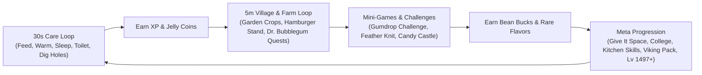

# Jelly Bean Simulator (`jelly-sim`) — Game Design & Technical Architecture Document

> **Companion Documents:**  
> - Canonical lore extraction: [TRANSCRIPT_EXTRACTION.md](file:///home/farrellm/workspace/jelly-sim/TRANSCRIPT_EXTRACTION.md)  
> - PR-by-PR implementation roadmap: [PLAN.md](file:///home/farrellm/workspace/jelly-sim/PLAN.md)

---

## 1. Executive Vision & Core Pillars

**Jelly Bean Simulator** is a cozy, hilariously over-engineered virtual pet, island village builder, farming sim, and bite-sized RPG inspired by the fictional hit game in the Story Pirates podcast. Built as a **100% client-side Single-Page Application (SPA)** hosted statically on **GitHub Pages**, it is engineered **iPhone-first** (portrait one-thumb touch UX, safe-area layout, offline PWA support) while scaling gracefully to desktop browsers (including "dual-monitor PC setups").

All 3D models, props, characters, environments, and studio-rendered 2D HUD icons are crafted through a reproducible **Blender MCP** asset pipeline.

### Core Design Pillars

1. **Survive -> Thrive Arc**: You begin on a humble plot of land with a helpless **Larva-stage** Jelly Bean crying *"Mama/Papa! Feed me!"* and gradually build a thriving, self-sufficient multi-bean island village—culminating in unlocking **Kitchen Skills**, graduating **Jelly College**, defeating the **Watermelon Witch**, and reaching absurdly joyful levels (**1 to 1497+**).
2. **Toyetic Candy-Diorama 3D (via Blender MCP)**: Glossy translucent-clay jelly beans, pastel gingerbread-meets-island architecture, cozy rain particles, and readable low-poly silhouettes built in Blender and rendered at 60 FPS on iPhone WebGL.
3. **One-Thumb iPhone Ergonomics**: Portrait-first camera diorama occupying the upper 70% of the screen, tactile thumb-zone action dock along the bottom safe area, snappy bottom-sheet drawers, and zero accidental Safari bounce/zoom.
4. **100% Client-Side, Zero Microtransactions**: Dual currencies (**Jelly Coins** and **Bean Bucks**), **Bonus Beans**, the **Viking Expansion Pack**, and even Lee's infamous **Time-Zone Flavor Hack** are lovingly implemented as pure client-side mechanics—zero backend servers, zero real money, zero ads.
5. **Cozy Humor & Respectful Moderation**: Celebrates the podcast's charm—including **Dr. Bubblegum's** stern-but-warm door-knock visits, **Baby Mode** secretly being Hard Mode, and an optional *"Dr. Bubblegum's 1-Hour Screen-Time Stretch Break"* cozy reminder.

### Transcript-to-Design Fidelity Matrix

| Transcript Concept | Real Game System |
|---|---|
| *"Jelly Bean hungry! Give it an apple"* / *"Make lunch"* | Core Hunger need + Apple feeding + Kitchen meal crafting |
| *"Jelly Bean cold. Papa help. Gather feathers to knit him a blanket"* | Weather cold snaps + Feather gathering & Blanket knitting mini-game |
| *"I'm so sleepy. Jellybean, sleep, sleep"* | Sleep need + cozy bed tuck-in + *"Soothing Sounds"* audio mode |
| *"Earned enough jelly coins to build a toilet"* | Hygiene need + Toilet building (first Jelly Coin construction milestone) |
| *"Angry at me... need 14 more bean bucks to give it space"* | Anger state + **"Give It Space"** plot expansion / Quiet Corner (costs Bean Bucks) |
| *"Still angry at me. Maybe I need to dig more holes"* | Tactile **Dig Hole** terrain action (cheap vent that drops anger slightly + unearths buried items) |
| *"Opened a hamburger stand"* | Village building generating passive Jelly Coins & burgers (boosted by Tomatoes!) |
| *"Unlocked kitchen skills... self-sufficient! Really changes the game"* | Mid-game skill milestone automating feeding & enabling multi-bean village scaling |
| *"Dr. Bubblegum... gives plot of land... knocked on my door"* | Animated NPC mentor with door-knock quest notifications & stern-to-sweet dialogue |
| *"Grew parsley, tomatoes, a candy cane, and 100 jelly beans"* | 4 signature garden crops (+ Apple Trees); harvesting **100 Jelly Beans** bursts 100 mini-beans & can sprout new villager beans |
| *"It's raining in my Jelly Bean village, so cozy!"* | Dynamic Cozy Rain weather: auto-waters crops, mood buff, 3D rain + soft Web Audio rain |
| *"Still in the larva stage... go to college and get a job"* | 5-stage Life Cycle: Larva -> Sprout -> College Scholar -> Career Citizen -> Elder/Legend |
| *"Level 1497... unlocked a new flavor"* | Fast, gratifying XP curve to Level 1497+ with 24+ glossy collectible Flavors |
| *"Completing a gumdrop challenge"* / *"play some more mini-games"* | Repeatable one-thumb **Gumdrop Challenge** & mini-games paying out **Bean Bucks** |
| *"Escaped a candy castle and defeated the watermelon witch"* | Turn/timing-based **Candy Castle** run & **Watermelon Witch** boss battle |
| *"Send jelly coins to 3 friends -> bonus bean -> buy more jelly coins"* | Client-side NPC Neighbor Gifting + shareable offline Gift Codes -> **Bonus Bean** payout |
| *"Set up each phone to a different time zone -> unlock unlimited flavors"* | **Time-Zone Flavor Dial** (reads local timezone for daily flavor + unlockable *"Lee's Multi-Phone Dial"* gadget) |
| *"Baby mode. It's a lot harder than regular mode"* | Selectable **Baby Mode** hard difficulty (2x decay, louder cries, fiercer anger, exclusive mustache badge) |
| *"Viking expansion pack... blacksmith by trade, swordsmith by hobby"* | Free unlockable **Viking Expansion Pack**: Fjord Dock, Forge, Blacksmith trade, Swordsmith hobby, Nordic raid quest |

---

## 2. Core Gameplay Loops



### 2.1 The 30-Second Tactile Loop (Care & Delight)
1. Open the SPA on iPhone; your glossy 3D Jelly Bean bounces toward the camera with a speech bubble & cute voice bark (`"Jelly Bean hungry!"`, `"Mama/Papa!"`).
2. Tap a quick-care button in the thumb dock (give an Apple, tuck into Bed, send to Toilet, drape Feather Blanket, or tap the island dirt to **Dig a Hole**).
3. Immediate squash-and-stretch 3D reaction, particle confetti, harmonic marimba chime, XP burst, and Jelly Coins pop into your counter.

### 2.2 The 5-Minute Loop (Garden, Village & Mini-Games)
1. Tap the glowing Garden plots to harvest **Parsley**, **Tomatoes**, **Candy Canes**, or **100 Jelly Beans** and replant seeds.
2. Collect accumulated Jelly Coins from the **Hamburger Stand** (extra revenue when stocked with home-grown Tomatoes & Parsley).
3. Hear a cheerful `*knock knock*` at your house door: **Dr. Bubblegum** has arrived with a stern-yet-encouraging task!
4. Need Bean Bucks to **Give It Space** or pay College Tuition? Jump into the 45-second **Gumdrop Challenge** mini-game.

### 2.3 The Session & Long-Term Loop (Thrive, Self-Sufficiency & Adventure)
1. Evolve your Jelly Bean out of the needy **Larva Stage**, build out the island with houses and fellow Jelly Beans, and unlock **Kitchen Skills**—transforming the game from high-touch baby care into thriving village management.
2. Send Jelly Beans to **Jelly College**, assign a **Trade** (Chef, Botanist, Merchant, **Blacksmith**) and a **Hobby** (Painter, Stargazer, **Swordsmith**).
3. Craft weapons/gear and venture across the Rainbow Bridge to escape the **Candy Castle** and defeat the **Watermelon Witch**.
4. Unlock the free **Viking Expansion Pack**, chase **Level 1497+**, collect all **24+ Flavors**, or start a second slot in **Baby Mode** for the ultimate challenge.

---

## 3. Detailed Game Systems

### 3.1 Needs, Moods & The Anger State Machine

Every active Jelly Bean tracks five continuous needs (`0.0` to `100.0`) plus an `anger` meter (`0.0` to `100.0`):

| Stat | Decay Rate (Regular Mode) | Decay Rate (Baby Mode) | Low-Threshold Cue (`< 30`) | Resolution |
|---|---|---|---|---|
| **Hunger** | `-2.2 / min` | `-4.4 / min` | `"Jelly Bean hungry!"` / `"Mama/Papa! Feed me!"` | Feed Apple (`+35`), Home-Cooked Lunch (`+65`), Hamburger (`+80`), or auto-eat via **Kitchen Skills** |
| **Warmth** | `-0.8 / min` (`-3.5 / min` in Cold Weather) | `-1.6 / min` (`-6.5 / min` in Cold) | `"Jelly Bean cold. Papa help."` + shivering shader | Equip **Knitted Feather Blanket** (`+100` & 90% cold resistance for 20 min) or indoor Hearth |
| **Sleep** | `-1.5 / min` | `-3.0 / min` | `"I'm so sleepy. Jellybean, sleep, sleep."` | Tap Bed to nap (`+25 / 10s` active rest, or full restore during offline rest) |
| **Hygiene** | `-1.3 / min` | `-2.8 / min` | Squirming emote + stink puff | Use **Toilet** (`+100` + `+5 JC` good-habit bonus; before Toilet is built, sponge bath only restores `+45`) |
| **Mood / Space** | Drifts toward average of other 4 needs | Decays `-2.0 / min` even when fed! | Frowns, stomps, turns red-tinted | Play, Cozy Rain (`+1.5 / min`), **Dig Holes**, or **Give It Space** |

#### Anger Mechanics: "Dig More Holes" vs. "Give It Space"
- Whenever any need sits below `20` or the island is crowded (more beans than personal space tiles), `anger` climbs (`+4 / min` Regular, `+9 / min` Baby Mode).
- At `anger >= 50`, the Jelly Bean enters the **Angry** state (furrowed eyebrows, tiny steam puffs, refuses passive job work until calmed).
- **Option A — Dig More Holes (Free, Quirky Vent)**: Tapping empty dirt plots digs a 3D hole with a satisfying *thwack*. Each hole reduces `anger` by `-8` (with diminishing returns per 5 minutes so digging 20 holes is funny and helpful, not an instant cure!) and has a 25% chance to unearth `3–12 Jelly Coins` or a buried Candy Shard. Holes visibly dot your island until refilled!
- **Option B — Give It Space (Bean Bucks Upgrade)**: Paying **14 Bean Bucks** (first tier; scales `14 -> 22 -> 35 -> 50 BB` for subsequent island rings) expands your island ring and creates a serene **Quiet Space Corner** (hammock/cushion under a lollipop tree). Instantly clears `anger` to `0`, raises permanent `maxSpaceCapacity`, and adds a `+20%` permanent Mood floor!

> **Cozy Safety Rule (Regular Mode):** A Jelly Bean **never dies**. In Regular Mode, offline needs floor at `10` so returning after days away greets you with a dramatic, grumpy-but-alive Jelly Bean ready for an apple and a hug. In **Baby Mode**, needs floor at `0` and anger hits `100` ("MEGA TANTRUM"), requiring active soothing before it resumes working!

---

### 3.2 Life Cycle, Levels (1–1497+) & Flavors

#### Five Life Stages
1. **Larva Stage (Levels 1–9)**: Tiny translucent pastel jelly grub/droplet with oversized wobbly eyes. Needs frequent hand-feeding, cries `"Mama/Papa!"`, cannot cook or work yet.
2. **Sprout Stage (Levels 10–29)**: Classic plump upright Jelly Bean silhouette with nubby limbs. Can farm, dig holes, knit blankets, and play all mini-games.
3. **Scholar / College Stage (Levels 30–59)**: Eligible to enroll in **Jelly College** (unlocks graduation cap cosmetic, **Kitchen Skills**, and major/trade training).
4. **Career Citizen (Levels 60–149)**: Fully self-sufficient adult Jelly Bean with an equipped **Trade** (income + island production) and **Hobby** (crafting + dungeon buffs), able to lead a multi-bean village.
5. **Elder / Legend (Levels 150–1497+)**: Unlocks Mythic Flavors, Prestige Village Monuments, Viking Raid mastery, and a joyful rapid-XP curve so hitting **Level 1497** (the exact level cited in the transcript!) is genuinely achievable and celebrated with a special *"1497 Certified Realistic Jelly Bean"* golden trophy!

#### Leveling Math (Built to Reach 1497+ Joyfully)
- Early levels (`1–30`) take ~1–3 minutes each so progression feels snappy on iPhone.
- Mid-to-high levels (`31–1497`) use a gentle polynomial curve `xpForLevel(L) = Math.floor(40 + 12 * L + 0.08 * L^2)` paired with village-wide multipliers (Hamburger Stand, Kitchen Skills, College Degrees, 100 Jelly Bean harvests, and Candy Castle clears) so active village empires rack up multiple levels per session and truly climb toward **1497** and beyond.

#### Collectible Flavors & The Time-Zone Dial
- **24 Base + 6 Secret Flavors** (e.g., *Classic Cherry*, *Very Berry*, *Sour Lime*, *Buttered Popcorn*, *Dr. Bubblegum Pink*, *Cozy Rain Blueberry*, *Watermelon Witch Swirl*, *Candy Cane Peppermint*, *Nordic Frostberry*, *1497 Gold Glaze*).
- Changing flavor swaps the Jelly Bean's glossy PBR shader tint, translucency sheen, and tiny passive perk (e.g., *Peppermint*: `-25%` cold decay; *Buttered Popcorn*: `+15%` Hamburger Stand coins; *Watermelon Swirl*: `+15%` Candy Castle attack).
- **Time-Zone Flavor Dial (Lee's Exploit Honored!)**:
  - One "Featured Flavor of the Hour" rotates by UTC offset (`Intl.DateTimeFormat().resolvedOptions().timeZone`).
  - At Level 25 (or via a Dr. Bubblegum side quest), players unlock **"Lee's Multi-Phone Time-Zone Dial"**—a comical desk prop holding 4 tiny phones set to Tokyo, London, New York, and Honolulu that lets you legitimately spin time zones in-game to discover rare flavors without tampering with your iPhone clock!

---

### 3.3 Kitchen Skills & Self-Sufficiency

Echoing the transcript (*"Your Jelly Beans aren't self-sufficient yet? Have you unlocked kitchen skills?" / "It really changes the game"*):
- Before Kitchen Skills: You manually feed every Jelly Bean (great intimate focus for your first 1–2 beans).
- Unlock requirement: Build the **Kitchen Annex** (`250 JC`) + graduate **Culinary 101** at Jelly College (`20 BB`) + complete the **Kitchen Rush** certification mini-game.
- Once unlocked:
  - Any Jelly Bean on the island automatically walks to the Kitchen/Pantry when `hunger < 45` and cooks a meal using harvested garden ingredients (or basic toast if pantry is empty).
  - Unlocks **Meal Recipes** (Apple Tart, Garden Salad with Parsley & Tomatoes, Super Jelly Burger, Peppermint Cocoa for Cold Snaps) that grant big XP & buff stacks.
  - Liberates the player to expand to **6–12 Villager Jelly Beans**, run the village economy, and focus on Candy Castle & Viking adventures!

---

### 3.4 Dual Economy & Client-Side "Bonus Bean" Social Loop

| Currency | Icon (Blender MCP) | Primary Sources | Primary Sinks |
|---|---|---|---|
| **Jelly Coins (JC)** | Glossy gold coin stamped with a jelly bean | Care actions, Garden harvests, Hamburger Stand passive income, Digging holes, Trades | Apples & Seeds, Toilet (`60 JC`), House upgrades, Kitchen Annex, Furniture, Villager Cottages, Blacksmith Forge |
| **Bean Bucks (BB)** | Crisp emerald-green candy banknote with a smiling bean | Mini-games (Gumdrop Challenge), Dr. Bubblegum quests, Candy Castle / Watermelon Witch, Daily achievements, Bonus Beans | **Give It Space** (`14 BB+`), College Tuition (`20 BB`), Rare Flavors (`15–30 BB`), **Viking Expansion Pack** (`50 BB` free in-game unlock!) |
| **Bonus Bean** | Iridescent rainbow jelly bean token | Send Jelly Coins to **3 friends** (NPC neighbors or real friends via offline Gift Code) | Redeem at the Candy Bank for a **Jelly Coin Jackpot** (`+300 JC`) OR **+10 Bean Bucks** |

#### How "Send Jelly Coins to 3 Friends" Works 100% Client-Side
1. **In-Island Neighbor Beans** (always works offline): Three quirky neighboring beans live on tiny nearby islets (*Captain Bean*, *Chef Bean*, *Professor Sprout*). Sending each `25 JC` via the Bottled-Mail Dock counts as 1 of 3 friends!
2. **Real Friend Offline Gift Codes** (optional fun via iPhone Share Sheet!): Generate a compact signed Base64 gift token (e.g. `JELLY-GIFT-7K9P-25JC`) containing `{ senderName, amount, nonce, checksum }`. Paste or tap a friend's link (`#gift=...`) to redeem once per nonce (deduplicated in `localStorage`) and increment your `3/3 Friends Gifted` Bonus Bean bar!

---

### 3.5 Island Village Grid & Buildings

The playable island is a floating pastel candy-meadow diorama divided into concentric rings of buildable hex/grid tiles:
- **Ring 0 (Starter Plot — gifted by Dr. Bubblegum)**: 7 tiles (Starter House, 2 Garden Beds, Open Yard for digging holes & placing Toilet).
- **Ring 1 (Unlocked via first "Give It Space" — `14 BB`)**: +12 tiles (Hamburger Stand, Quiet Space Corner, Apple Tree, expanded Garden).
- **Ring 2 (`22 BB`)**: +16 tiles (Kitchen Annex, Jelly College Campus, Feather Loom, Villager Cottages, Rainbow Bridge dock to Candy Castle).
- **Ring 3 (`35 BB`)**: +20 tiles (Grand Village Plaza, Trophy Pedestal, Lee's Time-Zone Booth).
- **Viking Fjord Pier (Viking Expansion Pack — `50 BB`)**: Attached Nordic timber pier & snowy cove holding the **Blacksmith Forge**, **Swordsmith Bench**, and **Longship Dock**.

#### Canonical Building Roster

| Building | Cost | Function |
|---|---|---|
| **Starter House** (Tiers 1–4) | Free (Dr. Bubblegum) / JC upgrades | Contains Bed (Sleep), Front Door (Dr. Bubblegum knocks here!), Cozy Hearth |
| **Toilet** | `60 JC` | Solves Hygiene need cleanly; iconic early milestone |
| **Garden Plot** (up to 12) | `30 JC` each | Grow Parsley, Tomatoes, Candy Cane, and 100 Jelly Beans |
| **Hamburger Stand** | `140 JC` | Passive JC income (`+15 JC/min`, doubled when supplied with Tomatoes & Parsley) + free burgers |
| **Quiet Space Corner** | `14 BB` ("Give It Space") | Permanently calms angry beans & unlocks Ring 1 |
| **Kitchen Annex** | `250 JC` | Unlocks Kitchen Skills & autonomous villager cooking |
| **Feather Loom** | `180 JC` | Craft Knitted Feather Blankets & warm scarves |
| **Jelly College** | `350 JC` + `20 BB` | Enroll Sprout+ beans for Culinary, Botany, Commerce, or Blacksmithing degrees |
| **Villager Cottage** (up to 5) | `220 JC` each | Houses additional Jelly Beans recruited via the "100 Jelly Beans" harvest or quests |
| **Blacksmith Forge** *(Viking Pack)* | `400 JC` | Enables Blacksmith trade (high JC income) & Swordsmith hobby (crafts swords for Candy Castle & Ice Giant raids!) |

---

### 3.6 Farming, Gathering & Crafting

#### Garden Crops (All 4 Canonical Crops + Apple Tree)

| Crop | Seed Cost | Grow Time | Harvest Yield | Special Hook |
|---|---|---|---|---|
| **Parsley** | `10 JC` | `45 sec` | `25 JC` + 2 Parsley | Fast check-in crop (*"checked in on the garden 12 times this morning!"*); garnishes Hamburger Stand for `+25%` tips |
| **Tomatoes** | `25 JC` | `2 min` | `65 JC` + 2 Tomatoes | Core ingredient for Hamburger Stand boost & Kitchen lunches |
| **Candy Cane** | `50 JC` | `4 min` | `145 JC` + 1 Candy Cane | High-value sweet crop; used in Peppermint Cocoa & Candy Castle healing potions |
| **100 Jelly Beans** | `90 JC` | `6 min` | Burst of **100 mini jelly beans** (`280 JC` + `35 XP`) | Comical 3D fountain of 100 bouncing mini-beans on harvest! First harvest + 15% chance thereafter sprouts a **new Villager Jelly Bean** if housing space exists! |
| **Apple Tree** *(Perennial)* | `80 JC` | `90 sec` regrow | 3 Apples | Replenishes your favorite feeding snack automatically |

#### Weather & Feather Blanket Crafting
- **Weather Cycle** (shifts every 6–10 real minutes, with manual weather forecast icon):
  - **Sunny**: Baseline balanced play.
  - **Cozy Rain**: Soft 3D rain streaks, rippling puddles, warm cozy lamp glow from houses, Web Audio gentle rain patter, **2x crop growth speed**, and `+1.5/min` cozy Mood boost!
  - **Chilly Wind**: Falling maple/candy leaves & **drifting Feathers** across the island; triggers `"Jelly Bean cold! Papa help!"` warmth drain. Tap 5 drifting feathers (or play the Feather Catch mini-game) -> knit a **Cozy Feather Blanket** at the Feather Loom!

---

### 3.7 Dr. Bubblegum & Quest Progression

**Dr. Bubblegum** is a spherical crunchy-pink bubblegum professor wearing tiny gold spectacles, a crisp white lab coat, and a mortarboard/bowtie.
- **Visual Personality**: Crisp glossy pink outer shell (his *"crunchy exterior"*) with a warm marshmallow-white collar/heart pin (*"a marshmallow with a heart of gold"*).
- **Door-Knock Mechanic**: Whenever a milestone quest is ready, an animated notification banner (`*KNOCK KNOCK* — Dr. Bubblegum is at your door!`) pulses over the House, and Dr. Bubblegum visibly stands on the doorstep tapping his cane.
- **Quest Arc (15 Hand-Crafted Main Quests + Infinite Radiant Tasks)**:
  1. *Welcome to Your Plot* -> Name your Jelly Bean & pick your parent title (`Mama` / `Papa` / `Captain`).
  2. *Survive First!* -> Feed an Apple & tuck your Larva Jelly Bean to sleep.
  3. *A Proper Bathroom* -> Earn `60 JC` and build a **Toilet**.
  4. *Green Thumb* -> Plant & harvest **Parsley** and **Tomatoes**.
  5. *Bundle Up!* -> Gather 5 Feathers and knit a **Blanket** during a chilly breeze.
  6. *Give It Space* -> Play **Gumdrop Challenge** to earn **14 Bean Bucks** and expand your island (or try digging 3 holes first—Dr. Bubblegum dryly comments on your hole-digging!).
  7. *Burger Tycoon* -> Open the **Hamburger Stand**.
  8. *The Hundred-Bean Harvest* -> Grow a **Candy Cane** and **100 Jelly Beans** to welcome your second Jelly Bean!
  9. *Off to College!* -> Build **Jelly College** and evolve out of the Larva/Sprout stages.
  10. *It Really Changes the Game* -> Unlock **Kitchen Skills** for self-sufficient Jelly Beans.
  11. *Three Friends, One Bonus Bean* -> Send Jelly Coins to 3 friends and redeem a **Bonus Bean**.
  12. *Storm the Candy Castle* -> Craft gear and defeat the **Watermelon Witch**.
  13. *Lee's Time-Zone Contraption* -> Unlock the Time-Zone Flavor Dial & discover 5 Flavors.
  14. *By Thor's Goats!* -> Unlock the **Viking Expansion Pack**, train a **Blacksmith**, and forge a **Swordsmith** blade.
  15. *Road to 1497* -> Reach Legend status and chase Level 1497!
- **Optional Screen-Time Cozy Break**: A toggleable setting (default ON, gentle & dismissible) where after 60 minutes of continuous play, Dr. Bubblegum knocks gently: *"Ahem! Even the finest Jelly Bean needs fresh air. Real-life chores are quests too—stretch your legs and come back later!"* (Awarding a *"Balanced Pirate"* `+10 BB` bonus if you take a 5-minute break!).

---

### 3.8 Mini-Games & Candy Castle Combat

All mini-games are built as crisp 30–60 second **one-thumb iPhone experiences** layered cleanly over the 3D scene or lightweight dedicated canvas:

1. **Gumdrop Challenge** *(Primary Bean Buck Earner)*:
   - Colored 3D gumdrops rain down 3 lanes toward a bouncy jelly trampoline. Tap/swipe to match your Jelly Bean's active flavor color, chain combos, dodge sour bombs.
   - Rewards: `4–12 Bean Bucks` + `30–100 Jelly Coins` + XP.
2. **Feather Catch & Knit** *(Warmth Crafting)*:
   - Drag your Jelly Bean left/right to catch drifting pastel feathers in the chilly breeze, then trace 3 quick stitch swipes to finish a **Knitted Blanket**.
3. **Hole Digger Rush** *(Anger Relief & Treasure)*:
   - Tap directly on island dirt tiles with rhythmic timing; pops up a dirt mound + 3D hole, relieves anger, and occasionally flips up buried Jelly Coins, worms, or rare flavor seeds.
4. **Kitchen Rush** *(Skill Certification & Buff Meals)*:
   - Catch falling Apples, Tomatoes, Parsley, and Burger Buns onto a sizzling plate in order to pass Culinary 101 and unlock **Kitchen Skills**.
5. **Candy Castle Escape & Watermelon Witch Boss Battle** *(Adventure RPG)*:
   - **3-Room Candy Castle Gauntlet**: Tap-timing encounters against Licorice Goblins & Jawbreaker Golems culminating in the **Watermelon Witch** (a cackling green-striped watermelon sorceress with a rind hat and seed-shooting wand!).
   - **Combat Loop**: Active turn-based one-thumb combat:
     - **Attack**: Tap a moving sweet-spot bar for Critical Swordsmith Strike (boosted by Viking forged swords!).
     - **Flavor Power**: Spend charge for flavor-themed spells (e.g., Peppermint Freeze, Bubblegum Shield).
     - **Snack Heal**: Eat an Apple or Candy Cane mid-battle.
     - **Dodge**: Tap right before the Watermelon Witch's *Seed Barrage* lands to deflect it!
   - **Rewards**: Escape victory cutscene, *Watermelon Swirl* Flavor unlock, `25 Bean Bucks`, huge XP boost, and Candy Castle Trophy.

---

### 3.9 Game Modes & Viking Expansion Pack

- **Regular Mode**: Cozy pacing, gentle offline floor, accessible to kids and casual players.
- **Baby Mode** *(Hard Mode!)*:
  - Presented with a hilarious tongue-in-cheek warning: *"BABY MODE — Much harder than Regular Mode. Recommended only for hardened veterans and babies with mustaches."*
  - `2.0x` need decay, `2.2x` anger rate, louder/more frequent `"Mama/Papa!"` cries, stricter Gumdrop Challenge speed, stronger Watermelon Witch, and an exclusive **Handlebar Mustache** cosmetic + **Baby Mode Crown** badge.
  - Supports **2 independent save slots** so players can keep both a cozy Regular Mode island and a chaotic Baby Mode island!
- **Viking Expansion Pack** *(Free In-Game Unlock at `50 BB`)*:
  - Snaps a snow-dusted **Nordic Fjord Pier** onto the island's north edge.
  - Unlocks the **Blacksmith Forge** (Blacksmith trade: high JC yield), **Swordsmith Bench** (Swordsmith hobby: craft Bronze, Iron, Candy-Steel, and Svoldaar Runeblade swords for combat), Viking Horned Helmet & Fur Cloak cosmetics, and 3 humorous Nordic raid encounters (*Battle of Svoldaar*, *Stamford Bridge*, and the challenging *Expedition to the Ice Giant's Palace*).

---

## 4. Art Direction & Blender MCP Asset Pipeline

### 4.1 Visual Style: "Glossy Clay & Candy Diorama"
- **Palette**: Warm mint-cream grass, strawberry-pink highlights, sky-blue ocean plane, rich translucent candy glazes on Jelly Beans (`roughness: 0.15–0.25`, subtle clearcoat/specular highlight), matte pastel clay on buildings (`roughness: 0.65–0.8`).
- **Proportions**: Chunky, toyetic silhouettes readable at iPhone screen width (`390px`), generous beveled edges so specular highlights catch cleanly without heavy normal maps.

### 4.2 Blender MCP Workflow Architecture

All visual assets are created programmatically and iteratively inspected through the workspace's **Blender MCP server** (`blender`), using a disciplined, reproducible pipeline:

1. **Source Scripts (`assets-src/scripts/*.py`)**: Every 3D asset is built by a deterministic `bpy` Python script invoked via Blender MCP (`execute_blender_code` for interactive iteration or `execute_blender_code_for_cli` for headless batch rebuilds).
2. **Source `.blend` Files (`assets-src/blend/*.blend`)**: Saved cleanly with organized Collections, applied transforms (`bpy.ops.object.transform_apply`), verified normals, and object origins placed at the **ground-center pivot `(0, 0, 0)`** (`Z = 0` at base in Blender -> `Y = 0` at base in glTF/Three.js).
3. **Visual Inspection via MCP**: During asset creation PRs, every asset is verified using `get_objects_summary` (polycount/bounds check) and `render_thumbnail_to_path` / `render_viewport_to_path` to visually inspect silhouette, proportions, and shading before committing.
4. **glTF 2.0 Export (`public/assets/models/*.glb`)**:
   - Export via `bpy.ops.export_scene.gltf(export_format='GLB', export_yup=True, export_apply=True, export_materials='EXPORT', export_colors=True)`.
   - Use **Principled BSDF flat/vertex-color materials** (or tiny shared `256x256` palette atlas) so individual `.glb` files stay ultra-lightweight (`15 KB – 120 KB`) and load instantaneously over mobile cellular on GitHub Pages.
5. **Cohesive 2D HUD Icons & App Icon (`public/assets/icons/*.png`)**:
   - Rendered directly from the same `.blend` models using a standardized orthographic studio camera + transparent PNG background (`film_transparent = True`, `128x128` for HUD icons, `512x512` for iOS `apple-touch-icon` & PWA icons) so 3D world and 2D UI look 100% unified.

### 4.3 Asset Budgets (iPhone Safari 60 FPS Target)

| Category | Max Triangles / Asset | Max `.glb` Size | Notes |
|---|---|---|---|
| Hero Jelly Bean (Larva / Adult) | `1,200 tris` | `45 KB` | Smooth subdivided bean + separate eyes/brows/mouth/accessories for programmatic squash-and-stretch & expressions |
| NPC (Dr. Bubblegum, Watermelon Witch) | `2,000 tris` | `75 KB` | Articulated head/arms/hat pivot empties |
| Island Base & Expansion Rings | `2,500 tris` | `85 KB` | Modular concentric rings toggled by expansion tier |
| Village Building (House, Toilet, Stand, Forge) | `1,500 tris` | `65 KB` | Clean silhouettes, baked AO in vertex colors |
| Crops, Items & Props (Apple, Blanket, Hole, Gumdrop) | `400 tris` | `20 KB` | Suitable for `THREE.InstancedMesh` batching |
| **Total Scene Active Budget** | **`<= 35,000 tris`** | **`< 4.5 MB` initial** | Candy Castle & Viking packs lazy-loaded on unlock |

### 4.4 Complete Blender MCP Asset Manifest

| Pack | Assets (`public/assets/models/*.glb` + `public/assets/icons/*.png`) | Milestone |
|---|---|---|
| **Core Pack** | `island_ring0.glb`, `jellybean_larva.glb`, `jellybean_adult.glb`, `starter_house.glb`, `apple.glb`, `bed_prop.glb`, `app_icon_512.png` | M0–M1 |
| **Village & NPC Pack** | `dr_bubblegum.glb`, `toilet.glb`, `hamburger_stand.glb`, `jelly_coin.glb`, `bean_buck.glb`, `bonus_bean.glb`, `quiet_space_corner.glb`, `island_ring1.glb` | M2, M4 |
| **Farm & Weather Pack** | `garden_plot.glb`, `crop_parsley.glb`, `crop_tomato.glb`, `crop_candycane.glb`, `crop_100beans.glb`, `apple_tree.glb`, `feather.glb`, `knitted_blanket.glb`, `feather_loom.glb`, `dug_hole.glb` | M3–M4 |
| **College & Life Pack** | `kitchen_annex.glb`, `jelly_college.glb`, `villager_cottage.glb`, `island_ring2.glb`, `grad_cap.glb`, `chef_hat.glb`, `timezone_dial.glb`, `gumdrop.glb` | M4–M5 |
| **Candy Castle Pack** *(Lazy)* | `candy_castle_arena.glb`, `watermelon_witch.glb`, `licorice_goblin.glb`, `castle_trophy.glb` | M6 |
| **Viking Expansion Pack** *(Lazy)* | `viking_fjord_pier.glb`, `blacksmith_forge.glb`, `swordsmith_bench.glb`, `viking_helmet.glb`, `candy_sword.glb`, `mustache_prop.glb` | M7 |

---

## 5. Audio & Iconic Jelly Bean Voice Design (100% Client-Side)

Zero audio server dependencies—all sound is generated or decoded cleanly via the browser's **Web Audio API** (unlocked on first `pointerdown` for iOS Safari compliance):

1. **Cozy Procedural Music Engine**: Lightweight Web Audio marimba/kalimba chord sequencer playing warm pentatonic loops (shifts to gentle lo-fi minor plucks during **Cozy Rain**, heroic brass-synth fanfare in **Candy Castle**, and Nordic drum-fiddle pulse on the **Viking Pier**).
2. **Tactile SFX**: Pop/squish on feeding, *dig-thwack* on hole digging, porcelain *flush* on Toilet, *knock-knock* wood rap for Dr. Bubblegum, coin clinks, crisp rain noise generator (bandpass-filtered pink noise).
3. **Jelly Bean Voice Barks**: Cute pitch-modulated formant synthesizer (or Web Speech API fallback / tiny pre-baked procedural vocal grain buffers) with expressive speech bubbles matching the canonical phrases:
   - `"Jelly Bean hungry!"` / `"{ParentTitle}! Feed me!"`
   - `"Jelly Bean cold! {ParentTitle} help!"`
   - `"I'm so sleepy. Jelly Bean, sleep, sleep..."`
4. **"Soothing Sounds" Sleep Radio (Transcript Stinger Easter Egg)**: A toggle in Settings that loops the sleepy/hungry Jelly Bean cries over soft rain—labeled *"100% Clinically Proven Soothing Sleep Sounds"*.

---

## 6. Technical Architecture (iPhone SPA + Static GitHub Pages)

### 6.1 Technology Stack

| Layer | Technology | Rationale |
|---|---|---|
| **Language & Build** | **TypeScript 5 + Vite 6** | Fast static ESM bundle, strict typing, trivial GitHub Pages `base` path config |
| **3D Renderer** | **Three.js** (imperative engine module) | Direct control over WebGL draw calls, instancing, `GLTFLoader`, iOS memory cleanup, zero React reconciliation overhead per frame |
| **UI / HUD Overlay** | **React 19 + CSS Modules** (or Tailwind CSS) | Snappy iPhone bottom-sheets, accessible touch targets (`>= 44x44pt`), safe-area layout, clean separation from 3D loop |
| **State Bridge** | **Pure TS Simulation Engine + Lightweight Pub/Sub Store** | Simulation runs headlessly with zero DOM/WebGL dependencies; HUD subscribes to throttled UI snapshots (`~10 Hz` or on discrete action) |
| **Testing** | **Vitest** (unit & simulation tests) + **Playwright** (mobile viewport smoke tests) | Full coverage of economy, decay, Baby Mode, offline catch-up, saves, and combat math |
| **Asset Pipeline** | **Blender MCP (`bpy`)** -> `.blend` -> `.glb` & `.png` | Version-controlled procedural 3D scripts & visually verified models |
| **Hosting & CI** | **GitHub Pages + GitHub Actions** | Static `dist/` artifact deployed automatically on push to `main` |

### 6.2 Client-Side Module Architecture

```
jelly-sim/
├── .github/workflows/deploy.yml      # Static build + GitHub Pages deploy
├── assets-src/
│   ├── scripts/                      # Deterministic Blender MCP bpy scripts
│   ├── blend/                        # Source .blend files
│   └── thumbnails/                   # MCP verification renders (gitignored or docs)
├── public/
│   ├── manifest.webmanifest          # iPhone / PWA Add-to-Home-Screen config
│   ├── sw.js                         # Lightweight offline cache service worker
│   └── assets/
│       ├── models/                   # Exported .glb files (core + lazy packs)
│       └── icons/                    # Blender-rendered studio PNG icons
├── src/
│   ├── sim/                          # 100% pure TypeScript game simulation (zero DOM/WebGL)
│   │   ├── types.ts                  # GameState, Bean, Building, Crop, Quest schemas
│   │   ├── constants.ts              # Balancing tables, recipes, flavors, levels 1–1497+
│   │   ├── rng.ts                    # Seeded Mulberry32 PRNG for deterministic tests
│   │   ├── engine.ts                 # tick(state, dt), dispatch(state, action), offlineCatchUp()
│   │   ├── needs.ts                  # Needs decay, Baby Mode modifiers, Anger/Hole/Space logic
│   │   ├── farm.ts                   # Crops, weather watering, 100 Jelly Beans burst
│   │   ├── village.ts                # Grid placement, Hamburger Stand, Kitchen Skills auto-feed
│   │   ├── quests.ts                 # Dr. Bubblegum door-knock progression
│   │   ├── minigames.ts              # Gumdrop Challenge, Feather Knit, Kitchen Rush state
│   │   ├── combat.ts                 # Candy Castle & Watermelon Witch + Viking raids
│   │   └── giftCodes.ts              # Client-side signed Base64 gift code generator/validator
│   ├── storage/
│   │   └── persistence.ts            # localStorage + IndexedDB backup, schema migrations, export/import
│   ├── render/
│   │   ├── SceneManager.ts           # Three.js renderer, camera orbit/pinch, DPR cap, resize, context-loss
│   │   ├── AssetLoader.ts            # GLTFLoader + caching + lazy pack streaming
│   │   ├── IslandView.ts             # Ring visibility, grid raycasting, buildings, dug holes
│   │   ├── BeanView.ts               # Squash-and-stretch procedural anims, flavor PBR shader, expressions
│   │   ├── WeatherView.ts            # Cozy Rain particles, wind feathers, day/night sky lighting
│   │   └── EffectsView.ts            # 100 Jelly Bean burst physics, floating coin pops, knock-knock icon
│   ├── audio/
│   │   └── AudioEngine.ts            # iOS-safe Web Audio synth, rain ambience, Jelly Bean voice barks
│   └── ui/
│       ├── App.tsx                   # Viewport shell, safe-area layout, canvas mount
│       ├── TopHud.tsx                # Jelly Coins, Bean Bucks, Level, Weather, Mode badge
│       ├── BottomDock.tsx            # One-thumb Care / Build / Farm / Play / Village tabs
│       ├── DialogueModal.tsx         # Dr. Bubblegum door-knock & quest cards
│       ├── MiniGameOverlay.tsx       # Gumdrop Challenge, Feather Catch, Candy Castle battle UI
│       └── SettingsModal.tsx         # Parent title, Baby Mode slot, Save Export, Screen-Time toggle
└── tests/                            # Vitest unit & integration suites
```

### 6.3 Core `GameState` Schema (Serializable JSON)

```ts
export interface GameState {
  schemaVersion: number;
  slotId: 'regular' | 'baby';
  mode: 'regular' | 'baby';
  parentTitle: 'Mama' | 'Papa' | 'Captain' | string;
  createdAtMs: number;
  lastTickMs: number;
  sessionPlaySeconds: number;
  currencies: {
    jellyCoins: number;
    beanBucks: number;
    bonusBeans: number;
  };
  island: {
    unlockedRing: 0 | 1 | 2 | 3;
    vikingPierUnlocked: boolean;
    tiles: Record<string, TileState>; // key: "q,r" hex/grid coord
    dugHoles: string[];               // tile keys with visible 3D holes
  };
  beans: JellyBeanEntity[];           // hero bean + recruited villager beans
  activeBeanId: string;
  inventory: {
    apples: number;
    parsley: number;
    tomatoes: number;
    candyCanes: number;
    feathers: number;
    blankets: number;
    swords: SwordItem[];
  };
  unlocks: {
    kitchenSkills: boolean;
    timeZoneDial: boolean;
    vikingPack: boolean;
    flavors: string[];
    trophies: string[];
  };
  weather: {
    current: 'sunny' | 'cozy_rain' | 'chilly_wind';
    nextChangeMs: number;
  };
  quests: {
    completedIds: string[];
    activeQuestId: string | null;
    drBubblegumAtDoor: boolean;
  };
  social: {
    friendsGiftedCount: number;       // resets every 3 -> awards 1 Bonus Bean
    redeemedGiftNonces: string[];
  };
  settings: {
    soundEnabled: boolean;
    soothingSoundsMode: boolean;
    screenTimeReminder: boolean;
    lowPowerMode: boolean;
  };
}
```

### 6.4 Deterministic Simulation & Offline Catch-Up
- **Active Play**: `requestAnimationFrame` accumulates frame delta and steps `engine.tick(state, FIXED_DT)` at `10 Hz` simulation ticks (`dt = 0.1s`) while the Three.js renderer interpolates visuals smoothly at `60 FPS`.
- **Offline Catch-Up**: On tab resume (`visibilitychange`) or app launch, `elapsedSec = clamp((now - state.lastTickMs) / 1000, 0, 12 * 3600)` is simulated cleanly in coarse steps:
  - Crops finish growing; Hamburger Stand & Blacksmiths accrue capped passive Jelly Coins.
  - Needs decay down to the mode floor (`10` in Regular Mode; `0` + Tantrum in Baby Mode).
  - If **Kitchen Skills** are unlocked, beans automatically consume pantry food while you're away and greet you with a cheerful *"Welcome Back Summary"* card!

### 6.5 iPhone Safari Engineering Standards
- **Viewport & Safe Area**: `height: 100dvh; overflow: hidden;`, padding via `env(safe-area-inset-top)` and `env(safe-area-inset-bottom)` so Dynamic Island and the iOS Home Indicator never obscure buttons.
- **Touch Ergonomics**:
  - Minimum `44x44px` tap targets; primary care/tab buttons anchored in the lower 30% thumb zone.
  - `touch-action: none` on the WebGL canvas; 1-finger tap raycasts island objects/beans, 1-finger horizontal drag smoothly orbits the diorama, 2-finger pinch adjusts zoom within clamped bounds.
  - `-webkit-user-select: none; -webkit-touch-callout: none;` to prevent long-press text selection popups.
- **Performance & Thermal Discipline**:
  - `renderer.setPixelRatio(Math.min(window.devicePixelRatio, lowPowerMode ? 1.5 : 2))`.
  - Single shadow-casting directional sun light (`1024x1024` shadow map) + hemisphere sky/ground fill light.
  - `THREE.InstancedMesh` for rain streaks, crops, dug holes, and the 100-Jelly-Bean harvest burst.
  - Graceful `webglcontextlost` recovery and immediate `localStorage` autosave on `pagehide` / `visibilitychange`.
- **Static GitHub Pages & PWA**:
  - Configured with Vite `base: process.env.BASE_PATH || '/jelly-sim/'` and relative asset URLs (`import.meta.env.BASE_URL + 'assets/...'`).
  - `manifest.webmanifest` + `apple-mobile-web-app-capable="yes"` + `apple-touch-icon` (rendered by Blender MCP) + stale-while-revalidate Service Worker for full offline iPhone play.

---

## 7. High-Level Milestones

| Milestone | Name | Core Goal | Exit Criteria |
|---|---|---|---|
| **M0** | **Foundation, GitHub Pages CI & Blender MCP Pipeline** | Establish the iPhone-first Vite/TS/React/Three.js SPA shell, Vitest harness, GitHub Pages static deployment, and verified Blender MCP `.blend -> .glb + .png` asset workflow. | Empty starter 3D island renders at 60 FPS on iPhone viewport; GitHub Actions builds & deploys `dist/`; Blender MCP script builds, exports, and thumbnails `island_ring0.glb` & `app_icon_512.png`. |
| **M1** | **Core Pet Care Loop ("Larva Stage: Survive")** | Implement the pure-TS Needs engine, save/offline catch-up persistence, animated Larva Jelly Bean, feeding Apples, Sleep, Hunger/Cold/Sleep speech bubbles, and client-side Web Audio barks. | Player can name their Jelly Bean, pick Mama/Papa, feed Apples, tuck to sleep, refresh Safari without losing state, and hear iOS-unlocked Jelly Bean cries. |
| **M2** | **Village Building, Dual Economy & Dr. Bubblegum** | Add Jelly Coins & Bean Bucks, island tile placement, Toilet & Hamburger Stand buildings, and Dr. Bubblegum's animated door-knock quest system. | Dr. Bubblegum greets player, grants starter plot, knocks on the door with tasks; player earns Jelly Coins to build a Toilet and opens a Hamburger Stand generating passive income. |
| **M3** | **Farming, Cozy Rain Weather & Feather Knitting** | Build the Garden system (Parsley, Tomatoes, Candy Cane, **100 Jelly Beans** burst, Apple Tree), dynamic Cozy Rain & Chilly Wind weather, and Feather Gathering -> Knitted Blanket crafting. | Crops grow & accelerate during 3D Cozy Rain; harvesting 100 Jelly Beans triggers a 100-bean physics fountain; player gathers feathers to knit a blanket when Jelly Bean cries `"Jelly Bean cold!"`. |
| **M4** | **Mini-Games, Hole Digging & "Give It Space"** | Ship the Anger state machine, tactile **Dig More Holes** mechanic, **Gumdrop Challenge** mini-game for Bean Bucks, and **"Give It Space"** (`14 BB`) Ring 1 island expansion. | Angry Jelly Bean can be vented by digging persistent 3D holes or fully soothed by earning 14+ Bean Bucks in Gumdrop Challenge to unlock Quiet Space Corner & Ring 1. |
| **M5** | **Life Cycle, Jelly College, Kitchen Skills & Village** | Implement 5-stage evolution (Larva -> Adult -> Legend), Jelly College enrollment, Kitchen Rush & **Kitchen Skills** self-sufficiency, multi-bean villagers, Flavors + **Time-Zone Dial**, and **Bonus Bean** client-side gifting. | Jelly Bean grows up, attends College, unlocks Kitchen Skills so villager beans auto-cook & feed themselves; Time-Zone Dial & 3-friend Bonus Bean loop work 100% offline. |
| **M6** | **Candy Castle Escape, Watermelon Witch & Levels 1–1497+** | Build the Candy Castle 3-room adventure & **Watermelon Witch** boss battle (lazy-loaded Blender MCP pack), flavor powers, trophies, and balanced XP curve scaling joyfully to Level 1497+. | Player enters Candy Castle, defeats the Watermelon Witch in one-thumb timing combat, earns the Watermelon Swirl flavor & Castle Trophy, and progression smoothly supports Level 1497+. |
| **M7** | **Baby Mode, Viking Expansion Pack & iPhone PWA Polish** | Deliver **Baby Mode** (Hard Mode save slot), free unlockable **Viking Expansion Pack** (Fjord Pier, Blacksmith trade, Swordsmith hobby, Nordic raids), Soothing Sounds radio, Screen-Time Cozy Break, and final iPhone performance/PWA polish. | All transcript mechanics playable end-to-end; Baby Mode verified harder; Viking Forge & Swordsmithing functional; offline PWA installs cleanly on iPhone with `< 4.5 MB` initial payload & steady 60 FPS. |
