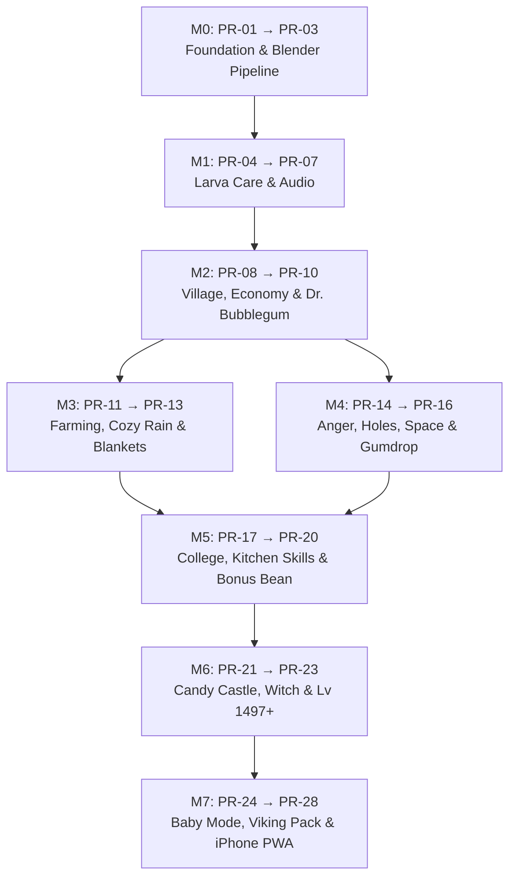

# Jelly Bean Simulator (`jelly-sim`) — Single-PR Implementation Plan

> **Companion Documents:**  
> - Canonical lore extraction: [TRANSCRIPT_EXTRACTION.md](file:///home/farrellm/workspace/jelly-sim/TRANSCRIPT_EXTRACTION.md)  
> - Full game design & architecture: [DESIGN.md](file:///home/farrellm/workspace/jelly-sim/DESIGN.md)

This plan breaks all **8 High-Level Milestones (`M0`–`M7`)** from `DESIGN.md` into **28 atomic, single-responsibility Pull Requests (`PR-01`–`PR-28`)**.

### PR Conventions
- **Single Concern**: Each PR focuses cleanly on either (a) a Blender MCP asset pack, (b) pure-TS client-side simulation logic + Vitest tests, or (c) Three.js rendering / iPhone HUD integration.
- **Static & Client-Only Invariant**: Every PR must pass `npm run build` producing a self-contained static `dist/` compatible with GitHub Pages subpath hosting (`import.meta.env.BASE_URL`).
- **Blender MCP Verification Rule**: Every asset PR commits its reproducible `assets-src/scripts/*.py` generator script, source `.blend`, exported `public/assets/models/*.glb`, and studio-rendered `public/assets/icons/*.png`, verified via Blender MCP `get_objects_summary` (triangle & origin check) and `render_thumbnail_to_path` (visual silhouette check).
- **iPhone Viewport Check**: Every UI/render PR is verified at `390x844` (iPhone 14/15 portrait) with safe-area insets and touch interactions.

---

## Dependency Overview

---

## Milestone 0: Foundation, GitHub Pages CI & Blender MCP Pipeline

### PR-01: Scaffold Vite + TypeScript + React + Three.js iPhone SPA & GitHub Pages CI
- **Depends On:** None
- **Goal:** Create a clean, strict TypeScript SPA scaffold with Vitest and automated static deployment to GitHub Pages.
- **Key Files & Changes:**
  - `package.json`, `tsconfig.json`, `vite.config.ts` (configurable `base` for GitHub Pages subpath `/jelly-sim/`)
  - `index.html` (iPhone meta tags: `viewport-fit=cover`, `user-scalable=no`, `apple-mobile-web-app-capable`, theme color)
  - `src/main.tsx`, `src/ui/App.tsx`, `src/ui/global.css` (`100dvh`, `env(safe-area-inset-*)`, `-webkit-user-select: none`)
  - `.github/workflows/deploy.yml` (runs `npm ci`, `npm test`, `npm run build`, uploads `dist/` to GitHub Pages)
  - `tests/smoke.test.ts` (initial Vitest health check)
- **Acceptance Criteria:**
  - `npm test` and `npm run build` pass cleanly with zero TypeScript errors.
  - Built `dist/index.html` references all assets via relative/configured base paths with zero hardcoded root `/` links.

### PR-02: Blender MCP Asset Pipeline Utilities & Core Starter Island Assets
- **Depends On:** `PR-01`
- **Goal:** Establish reusable Blender Python (`bpy`) helpers for clay/candy materials, ground-center origin normalization, glTF export, and orthographic icon rendering, and produce the first starter assets via Blender MCP.
- **Blender MCP Assets:**
  - `assets-src/scripts/common.py` (shared candy/clay Principled BSDF palette, origin-to-base helper, `export_glb()`, `render_icon_png()`)
  - `assets-src/scripts/build_core_island.py` (invoked via Blender MCP `execute_blender_code` / `execute_blender_code_for_cli`)
  - `assets-src/blend/core_island.blend`
  - `public/assets/models/island_ring0.glb` (`<= 2,000 tris`, floating pastel candy-grass starter island with 7 clear plot pads and shoreline rocks)
  - `public/assets/icons/app_icon_512.png` & `public/assets/icons/apple_touch_icon_180.png` (studio-rendered glossy jelly bean icon via Blender MCP)
- **Acceptance Criteria:**
  - `get_objects_summary` confirms `island_ring0.glb` origin at `(0,0,0)`, applied scale `(1,1,1)`, and triangle count within budget.
  - Visual inspection via `render_thumbnail_to_path` confirms clean silhouette and lighting.
  - `island_ring0.glb` is `< 100 KB`.

### PR-03: Three.js Diorama SceneManager, AssetLoader & iPhone Touch Camera
- **Depends On:** `PR-02`
- **Goal:** Mount a 60 FPS WebGL diorama displaying `island_ring0.glb` with responsive portrait framing and one-finger orbit / two-finger pinch controls.
- **Key Files & Changes:**
  - `src/render/AssetLoader.ts` (`GLTFLoader` with in-memory cache and base-URL path resolution)
  - `src/render/SceneManager.ts` (renderer with DPR capped at `2`, hemisphere + directional shadow light, sky/ocean backdrop, `webglcontextlost` recovery, resize handler)
  - `src/render/TouchCameraController.ts` (clamped polar/zoom orbit, `touch-action: none`, tap-vs-drag threshold so tapping tiles/beans never misfires)
  - `src/ui/CanvasViewport.tsx` (thin React mount hosting `SceneManager` imperatively)
- **Acceptance Criteria:**
  - Starter island renders cleanly at `390x844` portrait and desktop landscape without scrollbars or Safari rubber-banding.
  - Single-finger drag orbits smoothly; two-finger pinch zooms smoothly; FPS stays steady at 60 FPS in Chrome DevTools mobile emulation.

---

## Milestone 1: Core Pet Care Loop ("Larva Stage: Survive")

### PR-04: Blender MCP Hero Pet & Core Care Asset Pack
- **Depends On:** `PR-02`
- **Goal:** Create the Larva-stage Jelly Bean, Starter House, Apple, and Cozy Bed 3D models and matching HUD icons using Blender MCP.
- **Blender MCP Assets:**
  - `assets-src/scripts/build_pet_core.py` -> `assets-src/blend/pet_core.blend`
  - `public/assets/models/jellybean_larva.glb` (`<= 1,200 tris`, translucent glossy bean body + separate eye/eyebrow/mouth child nodes for procedural expressions)
  - `public/assets/models/starter_house.glb` (`<= 1,500 tris`, pastel cottage with distinct Front Door mesh for Dr. Bubblegum knocks)
  - `public/assets/models/apple.glb`, `public/assets/models/bed_prop.glb` (`<= 400 tris` each)
  - `public/assets/icons/apple.png`, `bed.png`, `larva.png` (`128x128` transparent studio PNGs)
- **Acceptance Criteria:**
  - Every model passes Blender MCP polycount, pivot, and `render_thumbnail_to_path` review.
  - Separate `Eyes`, `Brows`, and `Body` node names verified in glTF hierarchy for programmatic animation.

### PR-05: Pure-TS Simulation Core, Needs Engine & Client-Side Persistence
- **Depends On:** `PR-01`
- **Goal:** Build the headless, 100% deterministic TypeScript simulation engine for Larva care, onboarding state, `localStorage` + `IndexedDB` autosave, and offline elapsed-time catch-up.
- **Key Files & Changes:**
  - `src/sim/types.ts`, `src/sim/constants.ts`, `src/sim/rng.ts`
  - `src/sim/needs.ts` (Hunger, Warmth, Sleep, Hygiene, Mood decay + Regular Mode cozy floor `10`)
  - `src/sim/engine.ts` (`createInitialState`, `dispatch(state, action)`, `tick(state, dt)`, `applyOfflineCatchUp(state, nowMs)`)
  - `src/storage/persistence.ts` (`saveState`, `loadState`, schema version migration, `pagehide`/`visibilitychange` hook)
  - `tests/sim/needs.test.ts`, `tests/sim/offline.test.ts`, `tests/storage/persistence.test.ts`
- **Acceptance Criteria:**
  - Unit tests verify feeding an Apple restores Hunger & grants XP/JC, sleeping restores Sleep, offline catch-up caps at 12h without killing the bean, and corrupted `localStorage` gracefully falls back.

### PR-06: 3D Larva BeanView, Onboarding Flow & One-Thumb Care HUD
- **Depends On:** `PR-03`, `PR-04`, `PR-05`
- **Goal:** Connect the simulation to the 3D scene and iPhone HUD so players can name their Jelly Bean, pick `Mama`/`Papa`/`Captain`, feed Apples, and tuck it to sleep.
- **Key Files & Changes:**
  - `src/render/BeanView.ts` (idle jelly bounce, squash-and-stretch eat animation, shivering/sleepy poses, 3D-to-2D projected speech bubbles: `"Jelly Bean hungry!"`, `"Mama/Papa! Feed me!"`, `"I'm so sleepy. Jellybean, sleep, sleep."`)
  - `src/ui/OnboardingModal.tsx` (name Jelly Bean + choose parent title)
  - `src/ui/TopHud.tsx` (needs gauges, Level & XP bar)
  - `src/ui/BottomDock.tsx` (thumb-zone Care buttons with Blender-rendered PNG icons, `>= 48px` tap targets)
- **Acceptance Criteria:**
  - Tapping Feed tosses a 3D Apple into the Larva's bounce arc and updates Hunger immediately.
  - Refreshing the browser restores the exact bean name, stats, and level from `localStorage`.

### PR-07: Client-Side Web Audio Engine & Iconic Jelly Bean Voice Barks
- **Depends On:** `PR-06`
- **Goal:** Add zero-dependency client-side Web Audio sound effects, cozy marimba background music, and cute synthesized Jelly Bean vocal barks unlocked cleanly on iOS Safari.
- **Key Files & Changes:**
  - `src/audio/AudioEngine.ts` (iOS `AudioContext.resume()` on first `pointerdown`, mute toggle, master gain)
  - `src/audio/MusicSequencer.ts` (cozy pentatonic marimba/kalimba procedural loop)
  - `src/audio/VoiceSynth.ts` (playful pitch-chirp vocal synthesizer synced to speech bubbles: `"Jelly Bean!"`, `"Hungry!"`, `"Cold!"`, `"Sleep, sleep!"`)
  - `src/ui/AudioToggle.tsx`
- **Acceptance Criteria:**
  - Zero console warnings/errors on iOS Safari autoplay policy; audio starts smoothly after first tap and suspends cleanly on tab hide (`visibilitychange`).

---

## Milestone 2: Village Building, Dual Economy & Dr. Bubblegum

### PR-08: Blender MCP Village Buildings, Currencies & Dr. Bubblegum Pack
- **Depends On:** `PR-02`
- **Goal:** Model Dr. Bubblegum, the Toilet, Hamburger Stand, and currency icons via Blender MCP.
- **Blender MCP Assets:**
  - `assets-src/scripts/build_village_m2.py` -> `assets-src/blend/village_m2.blend`
  - `public/assets/models/dr_bubblegum.glb` (`<= 2,000 tris`, glossy crunchy-pink sphere professor, gold spectacles, white lab coat, marshmallow heart lapel pin, cane)
  - `public/assets/models/toilet.glb` (`<= 1,000 tris`, adorable pastel outdoor restroom)
  - `public/assets/models/hamburger_stand.glb` (`<= 1,500 tris`, striped candy-awning burger booth with giant burger rooftop sign)
  - `public/assets/icons/dr_bubblegum.png`, `toilet.png`, `hamburger_stand.png`, `jelly_coin.png`, `bean_buck.png`, `bonus_bean.png`
- **Acceptance Criteria:**
  - All models pass Blender MCP polycount, pivot, and thumbnail inspection.
  - Dr. Bubblegum's portrait icon renders crisp and recognizable at `64x64` on mobile.

### PR-09: Dual Economy, Tile Building System, Toilet & Hamburger Stand
- **Depends On:** `PR-06`, `PR-08`
- **Goal:** Implement Jelly Coins & Bean Bucks balances, grid-based building placement on Ring 0 tiles, Toilet Hygiene resolution, and Hamburger Stand passive Jelly Coin generation.
- **Key Files & Changes:**
  - `src/sim/village.ts` (`placeBuilding`, `upgradeHouse`, `useToilet`, `collectStandIncome`, building cost tables)
  - `src/render/IslandView.ts` (raycastable tile pads, ghost placement highlight, mounted building `.glb` instances, floating `+JC` popups)
  - `src/ui/BuildSheet.tsx` (iPhone bottom-sheet Build catalog showing Jelly Coin vs. Bean Buck costs)
  - `tests/sim/village.test.ts`
- **Acceptance Criteria:**
  - Earning `60 JC` unlocks & places the **Toilet**, restoring Hygiene to `100%` with flush SFX.
  - Opening the **Hamburger Stand** (`140 JC`) accrues passive Jelly Coins over time (including offline catch-up) and lets the player tap to collect or grab a free burger.

### PR-10: Dr. Bubblegum Door-Knock Event & Quest System
- **Depends On:** `PR-08`, `PR-09`
- **Goal:** Bring Dr. Bubblegum onto the island as your stern-but-warm professor who gifts your starter plot and physically knocks on your house door with new tasks.
- **Key Files & Changes:**
  - `src/sim/quests.ts` (declarative quest registry for Main Quests 1–15 + infinite radiant tasks, progress evaluators, reward payouts in JC & BB)
  - `src/render/NpcView.ts` (spawns `dr_bubblegum.glb` at the house doorstep with cane-tap animation + pulsing `*KNOCK KNOCK*` indicator)
  - `src/ui/DialogueModal.tsx` (Dr. Bubblegum portrait, crunchy-stern dialogue softening into encouragement, claim reward button)
  - `tests/sim/quests.test.ts`
- **Acceptance Criteria:**
  - Opening a new save triggers Dr. Bubblegum's welcome & starter-plot gift.
  - Completing a quest causes Dr. Bubblegum to appear at the door with a wood-knock SFX and award Jelly Coins / Bean Bucks upon tap.

---

## Milestone 3: Farming, Cozy Rain Weather & Feather Knitting

### PR-11: Blender MCP Farm Crops, Apple Tree & Feather Blanket Pack
- **Depends On:** `PR-02`
- **Goal:** Build all 4 canonical garden crops, the perennial Apple Tree, drifting Feathers, Feather Loom, and Knitted Blanket via Blender MCP.
- **Blender MCP Assets:**
  - `assets-src/scripts/build_farm_m3.py` -> `assets-src/blend/farm_m3.blend`
  - `public/assets/models/garden_plot.glb`, `crop_parsley.glb`, `crop_tomato.glb`, `crop_candycane.glb`, `crop_100beans.glb`, `apple_tree.glb`
  - `public/assets/models/feather.glb`, `knitted_blanket.glb`, `feather_loom.glb`
  - Matching studio-rendered `128x128` PNG icons in `public/assets/icons/`
- **Acceptance Criteria:**
  - All crop models (`<= 400 tris`) support scale-growth stages (sprout -> mid -> ripe glow) and clean instancing.
  - `knitted_blanket.glb` fits cleanly draped around `jellybean_larva.glb` / `jellybean_adult.glb`.

### PR-12: Pure-TS Garden Farming Engine & Dynamic Weather System
- **Depends On:** `PR-09`
- **Goal:** Implement planting, watering, crop timers, Hamburger Stand Tomato/Parsley synergy, the **100 Jelly Beans** harvest payout, and dynamic Sunny / Cozy Rain / Chilly Wind weather cycles.
- **Key Files & Changes:**
  - `src/sim/farm.ts` (plant, water, harvest Parsley, Tomatoes, Candy Cane, 100 Jelly Beans, Apple Tree regrow)
  - `src/sim/weather.ts` (deterministic weather scheduler; Cozy Rain grants `2x` crop growth + auto-water + mood buff; Chilly Wind spikes Warmth drain + spawns collectible Feathers)
  - `tests/sim/farm.test.ts`, `tests/sim/weather.test.ts`
- **Acceptance Criteria:**
  - Unit tests verify exact crop timings, Cozy Rain 2x speed multiplier, Tomato/Parsley bonus on Hamburger Stand, and `100 Jelly Beans` burst yield.

### PR-13: 3D Garden Rendering, 100-Bean Burst, Cozy Rain & Feather Knitting Mini-Game
- **Depends On:** `PR-11`, `PR-12`
- **Goal:** Visualize crops, Cozy Rain particles + rain audio, the comical 100-Jelly-Bean harvest fountain, and the Feather Catch -> Knit Blanket flow when your bean cries `"Jelly Bean cold! Papa help!"`.
- **Key Files & Changes:**
  - `src/render/WeatherView.ts` (instanced 3D rain streaks, cozy sky lighting shift, drifting clickable feathers during Chilly Wind, Web Audio soft rain layer)
  - `src/render/EffectsView.ts` (instanced 100-mini-bean physics fountain burst on harvesting `100 Jelly Beans`!)
  - `src/ui/GardenSheet.tsx` (seed selector, growth progress timers, `"Checked garden X times today"` fun stat counter!)
  - `src/ui/FeatherKnitOverlay.tsx` (one-thumb catch & 3-swipe knit interaction crafting a Knitted Blanket and draping it on the bean)
- **Acceptance Criteria:**
  - Harvesting **100 Jelly Beans** erupts 100 colorful bouncing mini-beans at 60 FPS on iPhone viewport.
  - During Chilly Wind, Jelly Bean shivers (`"Jelly Bean cold!"`); gathering 5 feathers and knitting a blanket visibly wraps the bean and restores Warmth.

---

## Milestone 4: Mini-Games, Hole Digging & "Give It Space"

### PR-14: Blender MCP Island Ring 1, Quiet Space Corner, Dug Hole & Gumdrop Pack
- **Depends On:** `PR-02`
- **Goal:** Create the Ring 1 expansion terrain, Quiet Space Corner, persistent Dug Hole divot, and glossy Gumdrop meshes via Blender MCP.
- **Blender MCP Assets:**
  - `assets-src/scripts/build_space_m4.py` -> `assets-src/blend/space_m4.blend`
  - `public/assets/models/island_ring1.glb` (`<= 2,200 tris`, seamlessly docks around `island_ring0.glb`)
  - `public/assets/models/quiet_space_corner.glb` (`<= 1,200 tris`, cozy hammock & lollipop shade tree)
  - `public/assets/models/dug_hole.glb`, `public/assets/models/gumdrop.glb` (`<= 350 tris` each)
  - Matching HUD icons in `public/assets/icons/`
- **Acceptance Criteria:**
  - `island_ring1.glb` aligns flush with `island_ring0.glb` with zero Z-fighting or seam gaps.
  - Verified via Blender MCP thumbnail render showing Ring 0 + Ring 1 assembled together.

### PR-15: Anger State Machine, "Dig More Holes" & "Give It Space" (`14 BB`)
- **Depends On:** `PR-09`, `PR-14`
- **Goal:** Implement the Jelly Bean Anger state, tactile hole digging on empty dirt tiles, and the `14 Bean Bucks` **"Give It Space"** upgrade that unlocks Ring 1 and builds the Quiet Space Corner.
- **Key Files & Changes:**
  - `src/sim/needs.ts` (expand with Anger climb, Angry expression threshold, `digHole(tileKey)` diminishing anger vent + buried loot table, `giveItSpace()` Ring expansion)
  - `src/render/IslandView.ts` (mount `island_ring1.glb` on unlock, render persistent `dug_hole.glb` instances & dirt-puff particles on tap)
  - `src/render/BeanView.ts` (furrowed angry brows, tiny steam puffs, relaxed hammock pose when in Quiet Space)
  - `tests/sim/anger.test.ts`
- **Acceptance Criteria:**
  - Tapping dirt digs a visible 3D hole with *thwack* SFX, drops Anger slightly, and occasionally pops buried Jelly Coins.
  - Spending `14 BB` on **"Give It Space"** animates Ring 1 snapping onto the island, clears Anger to `0`, and raises permanent space capacity.

### PR-16: One-Thumb "Gumdrop Challenge" Mini-Game (Bean Bucks Earner)
- **Depends On:** `PR-14`, `PR-15`
- **Goal:** Deliver the signature repeatable 45-second **Gumdrop Challenge** mini-game so players can earn Bean Bucks purely through fun gameplay.
- **Key Files & Changes:**
  - `src/sim/minigames.ts` (3-lane falling gumdrop wave generator, flavor-color matching combo multiplier, sour bomb hazard, Bean Buck & XP payout formula)
  - `src/ui/GumdropChallengeModal.tsx` (responsive touch-lane canvas/overlay playable with one thumb on iPhone, high-score tracking, instant replay)
  - `tests/sim/minigames.test.ts`
- **Acceptance Criteria:**
  - One complete 45s Gumdrop Challenge run reliably awards `4–12 Bean Bucks`, updates Dr. Bubblegum quests, and runs smoothly at 60 FPS on mobile Safari.

---

## Milestone 5: Life Cycle, Jelly College, Kitchen Skills & Multi-Bean Village

### PR-17: Blender MCP Adult Bean, College, Kitchen & Time-Zone Dial Pack
- **Depends On:** `PR-02`
- **Goal:** Produce the Adult Jelly Bean mesh, Ring 2 expansion, Kitchen Annex, Jelly College, Villager Cottage, wearable hats, and Lee's Multi-Phone Time-Zone Dial via Blender MCP.
- **Blender MCP Assets:**
  - `assets-src/scripts/build_village_m5.py` -> `assets-src/blend/village_m5.blend`
  - `public/assets/models/jellybean_adult.glb` (`<= 1,200 tris`, plump expressive bean with hat/accessory socket empty)
  - `public/assets/models/island_ring2.glb`, `kitchen_annex.glb`, `jelly_college.glb`, `villager_cottage.glb`
  - `public/assets/models/grad_cap.glb`, `chef_hat.glb`, `timezone_dial.glb` (4 tiny phones on a rotary candy stand!)
  - Matching PNG icons in `public/assets/icons/`
- **Acceptance Criteria:**
  - Accessory socket empty (`HatSocket`) aligns cleanly across `grad_cap.glb` and `chef_hat.glb`.
  - Ring 0 + Ring 1 + Ring 2 assemble seamlessly in Blender MCP verification render.

### PR-18: 5-Stage Life Cycle, Jelly College, Kitchen Rush & Kitchen Skills Self-Sufficiency
- **Depends On:** `PR-12`, `PR-16`, `PR-17`
- **Goal:** Implement Larva -> Sprout -> Scholar -> Career -> Legend evolution, Jelly College degrees, the **Kitchen Rush** certification mini-game, and **Kitchen Skills** autonomous feeding.
- **Key Files & Changes:**
  - `src/sim/lifecycle.ts` (stage transitions, College enrollment & Trades/Hobbies, Kitchen Skills autonomous pantry cooking during active & offline ticks, Meal Recipes)
  - `src/ui/CollegeModal.tsx` (choose major/trade & hobby, enroll bean, graduation celebration)
  - `src/ui/KitchenRushModal.tsx` (quick ingredient-catch certification mini-game)
  - `tests/sim/lifecycle.test.ts`
- **Acceptance Criteria:**
  - Evolving out of Larva swaps `jellybean_larva.glb` -> `jellybean_adult.glb` with celebratory particles.
  - Once **Kitchen Skills** are unlocked, beans autonomously cook & eat when `hunger < 45` (including during offline catch-up!), displaying a *"Your Jelly Beans made their own lunch!"* toast.

### PR-19: Multi-Bean Village Population, 24+ Flavors & "Lee's Time-Zone Flavor Dial"
- **Depends On:** `PR-17`, `PR-18`
- **Goal:** Support recruiting & housing multiple autonomous Jelly Beans on the island, swapping 24+ glossy PBR Flavors with passive perks, and unlocking Lee's Time-Zone Flavor Dial.
- **Key Files & Changes:**
  - `src/sim/flavors.ts` (24 base + 6 secret flavor definitions, real timezone UTC-offset daily featured flavor, unlockable Time-Zone Dial selector)
  - `src/render/BeanView.ts` (multi-bean wandering AI across island tiles, dynamic glossy PBR flavor shader tinting, hat attachment, tap-to-focus bean selector)
  - `src/ui/FlavorWardrobeSheet.tsx` & `src/ui/TimeZoneDialModal.tsx`
  - `tests/sim/flavors.test.ts`
- **Acceptance Criteria:**
  - Harvesting **100 Jelly Beans** with an empty Villager Cottage spawns a new named Jelly Bean wandering the village.
  - Spinning **Lee's Multi-Phone Time-Zone Dial** legitimately unlocks regional flavors without touching device clock settings.

### PR-20: Client-Side "3 Friends -> Bonus Bean" Neighbor Mail & Offline Gift Codes
- **Depends On:** `PR-10`, `PR-19`
- **Goal:** Implement Lee's *"send jelly coins to 3 friends -> get a bonus bean -> buy more jelly coins"* loop 100% client-side via NPC neighbor mail and shareable signed offline Gift Codes.
- **Key Files & Changes:**
  - `src/sim/giftCodes.ts` (deterministic Base64 + FNV-1a checksum gift token encode/decode, nonce deduplication, `#gift=...` URL hash auto-reader)
  - `src/sim/social.ts` (3 NPC neighbor beans + real-friend code tracking, 3/3 progress -> awards `1 Bonus Bean`, Candy Bank exchange -> `+300 JC` or `+10 BB`)
  - `src/ui/GiftMailModal.tsx` (send coins to neighbors, iOS native `navigator.share` / copy gift link, redeem friend code)
  - `tests/sim/giftCodes.test.ts`
- **Acceptance Criteria:**
  - Works 100% offline with zero backend.
  - Tampered or already-redeemed gift codes are rejected cleanly; gifting 3 friends awards a **Bonus Bean** redeemable for Jelly Coins.

---

## Milestone 6: Candy Castle Escape, Watermelon Witch & Levels 1–1497+

### PR-21: Blender MCP Candy Castle & Watermelon Witch Lazy Asset Pack
- **Depends On:** `PR-02`
- **Goal:** Create the lazy-loaded Candy Castle arena, Watermelon Witch boss, Licorice Goblin, and Castle Trophy models via Blender MCP.
- **Blender MCP Assets:**
  - `assets-src/scripts/build_candy_castle_m6.py` -> `assets-src/blend/candy_castle_m6.blend`
  - `public/assets/models/candy_castle_arena.glb` (`<= 2,500 tris`, wafer battlements, frosted sugar archway)
  - `public/assets/models/watermelon_witch.glb` (`<= 2,000 tris`, striped green watermelon body, curled rind witch hat, seed-blasting wand)
  - `public/assets/models/licorice_goblin.glb`, `public/assets/models/castle_trophy.glb`
  - Matching PNG icons in `public/assets/icons/`
- **Acceptance Criteria:**
  - Assets live in a dedicated lazy-loaded manifest group so initial SPA boot payload stays `< 4.5 MB`.
  - Visual review via Blender MCP `render_thumbnail_to_path` confirms iconic Watermelon Witch silhouette.

### PR-22: Candy Castle 3-Room Escape & Watermelon Witch Boss Battle
- **Depends On:** `PR-19`, `PR-21`
- **Goal:** Implement the turn/timing-based one-thumb Candy Castle adventure culminating in escaping the castle and defeating the **Watermelon Witch**.
- **Key Files & Changes:**
  - `src/sim/combat.ts` (3-room encounter state machine, active timing strike multiplier, Flavor Powers, Apple/Candy Cane healing, Seed Barrage dodge window, loot drops)
  - `src/render/BattleScene.ts` (lazy-loads Candy Castle pack, frames hero Jelly Bean vs. Watermelon Witch, plays hit-stop & seed projectile particles)
  - `src/ui/BattleOverlay.tsx` (one-thumb Attack Timing Bar, Flavor Spell, Snack Heal, and Dodge button)
  - `tests/sim/combat.test.ts`
- **Acceptance Criteria:**
  - Defeating the Watermelon Witch plays the Candy Castle Escape celebration, unlocks **Watermelon Swirl** flavor, awards `25 BB` + `Castle Trophy`, and safely returns to the island diorama (disposing temporary battle GPU resources).

### PR-23: High-Level Progression Curve (Levels 1–1497+), Ring 3 Plaza & Trophy Showcase
- **Depends On:** `PR-22`
- **Goal:** Tune the late-game XP multipliers, add Ring 3 Grand Plaza & Trophy Pedestal, and ensure leveling smoothly scales to and celebrates **Level 1497+**.
- **Blender MCP Assets:**
  - `assets-src/scripts/build_ring3_m6.py` -> `public/assets/models/island_ring3.glb`, `trophy_1497.glb` + icon
- **Key Files & Changes:**
  - `src/sim/constants.ts` (verified `xpForLevel(1..2000)` curve + village synergy multipliers)
  - `src/sim/achievements.ts` (milestones including `"Level 1497 Certified Realistic Jelly Bean"`, `"Checked Garden 12 Times"`, `"Self-Sufficient Village"`)
  - `src/ui/TrophyModal.tsx`
  - `tests/sim/progression1497.test.ts` (automated Monte Carlo / simulated progression test verifying healthy pacing from Lv 1 -> Lv 1497)
- **Acceptance Criteria:**
  - Reaching Level 1497 unlocks the golden `1497` trophy & *1497 Gold Glaze* flavor with zero integer overflow or UI layout truncation on `390px` width.

---

## Milestone 7: Baby Mode, Viking Expansion Pack & iPhone PWA Polish

### PR-24: Blender MCP Viking Expansion Pack & Baby Mode Mustache Assets
- **Depends On:** `PR-02`
- **Goal:** Create the lazy-loaded Nordic Fjord Pier, Blacksmith Forge, Swordsmith Bench, Viking Helmet, Candy Swords, and Baby-with-a-Mustache prop via Blender MCP.
- **Blender MCP Assets:**
  - `assets-src/scripts/build_viking_m7.py` -> `assets-src/blend/viking_m7.blend`
  - `public/assets/models/viking_fjord_pier.glb` (`<= 2,000 tris`, snow-dusted Nordic pier & miniature longship)
  - `public/assets/models/blacksmith_forge.glb`, `public/assets/models/swordsmith_bench.glb`
  - `public/assets/models/viking_helmet.glb`, `public/assets/models/candy_sword.glb`, `public/assets/models/mustache_prop.glb`
  - Matching PNG icons in `public/assets/icons/`
- **Acceptance Criteria:**
  - `viking_fjord_pier.glb` docks cleanly to the island edge without clipping Ring 0–3 tiles.
  - `viking_helmet.glb` and `mustache_prop.glb` snap cleanly to the bean's accessory sockets.

### PR-25: Dual Save Slots & "Baby Mode" (Hard Mode Difficulty)
- **Depends On:** `PR-15`, `PR-24`
- **Goal:** Implement independent Regular Mode and **Baby Mode** save slots, making Baby Mode genuinely and hilariously harder than Regular Mode.
- **Key Files & Changes:**
  - `src/storage/persistence.ts` (slot switching between `'regular'` and `'baby'`, isolated keys)
  - `src/sim/needs.ts` & `src/sim/combat.ts` (`mode === 'baby'` multipliers: `2.0x` need decay, `2.2x` anger, Mega Tantrum at `100` anger, faster Gumdrops, tougher Watermelon Witch)
  - `src/ui/ModeSwitchModal.tsx` (tongue-in-cheek Baby Mode warning, equips `mustache_prop.glb` badge in Baby Mode)
  - `tests/sim/babymode.test.ts`
- **Acceptance Criteria:**
  - Switching between Regular and Baby Mode preserves both islands independently.
  - Automated tests prove Baby Mode decays needs `2x` faster and triggers Mega Tantrum when neglected.

### PR-26: Free Unlockable Viking Expansion Pack (Blacksmith, Swordsmith & Nordic Raids)
- **Depends On:** `PR-22`, `PR-24`
- **Goal:** Enable unlocking the free **Viking Expansion Pack** (`50 BB`), docking the Fjord Pier, training **Blacksmith** trade & **Swordsmith** hobby beans, forging combat swords, and tackling Nordic raid quests.
- **Key Files & Changes:**
  - `src/sim/viking.ts` (unlock pack, forge Bronze / Iron / Candy-Steel / Svoldaar Runeblade swords, Nordic encounters: *Battle of Svoldaar*, *Stamford Bridge*, *Ice Giant's Palace*)
  - `src/render/IslandView.ts` (lazy-load and dock `viking_fjord_pier.glb`, render Forge & Swordsmith Bench)
  - `src/ui/ForgeModal.tsx` (craft & equip forged swords for Candy Castle & Raid combat)
  - `tests/sim/viking.test.ts`
- **Acceptance Criteria:**
  - Unlocking the Viking Expansion Pack attaches the snowy Fjord Pier without reloading the page.
  - A bean assigned **Blacksmith by trade** and **Swordsmith by hobby** generates Forge income and crafts swords that visibly boost combat damage.

### PR-27: Episode Meta-Delights ("Soothing Sounds", Screen-Time Break) & Save Backup
- **Depends On:** `PR-07`, `PR-10`, `PR-25`
- **Goal:** Add the podcast's signature meta-humor settings and rock-solid client-side Save JSON/Base64 Export & Import for switching devices (e.g., iPhone <-> dual-monitor PC).
- **Key Files & Changes:**
  - `src/audio/SoothingSoundsMode.ts` (loops cozy rain + sleepy/hungry Jelly Bean voice lines from the episode stinger!)
  - `src/sim/screentime.ts` (optional 60-minute session timer triggering Dr. Bubblegum's gentle real-life stretch/chore break + `+10 BB` *"Balanced Pirate"* return bonus)
  - `src/ui/SettingsModal.tsx` (toggles, Save Export/Import copy-paste box, Reset Save with confirmation)
  - `tests/storage/exportImport.test.ts`
- **Acceptance Criteria:**
  - Exporting a save string on one browser and importing it on another restores 100% of island state, flavors, buildings, and quests.
  - Screen-Time Cozy Break can be toggled cleanly and never locks the player out.

### PR-28: iPhone PWA Offline Support, Performance Audit & GitHub Pages Release
- **Depends On:** `PR-23`, `PR-25`, `PR-26`, `PR-27`
- **Goal:** Finalize PWA Add-to-Home-Screen offline play on iPhone, verify WebGL memory/frame budgets, add Playwright mobile viewport end-to-end tests, and publish the release build to GitHub Pages.
- **Key Files & Changes:**
  - `public/manifest.webmanifest` (standalone display, portrait orientation, Blender-rendered icons)
  - `public/sw.js` + registration in `src/main.tsx` (offline cache for app shell + `.glb` models, clean cache busting on new deploys)
  - `src/ui/SettingsModal.tsx` (Low-Power 30fps / 1.5x DPR toggle for older iPhones)
  - `tests/e2e/mobile-smoke.spec.ts` (Playwright iPhone 14 viewport test: onboard -> feed -> build toilet -> plant crop -> Gumdrop Challenge -> reload persistence)
  - `README.md` (how to play on iPhone, Add-to-Home-Screen guide, local dev & Blender MCP asset rebuild instructions)
- **Acceptance Criteria:**
  - Initial asset payload `< 4.5 MB`; active island draw calls `<= 40`; active triangles `<= 35,000`.
  - App launches offline from iOS Home Screen after first visit.
  - All Vitest unit tests, Playwright mobile smoke tests, and GitHub Pages deploy workflow pass green.
